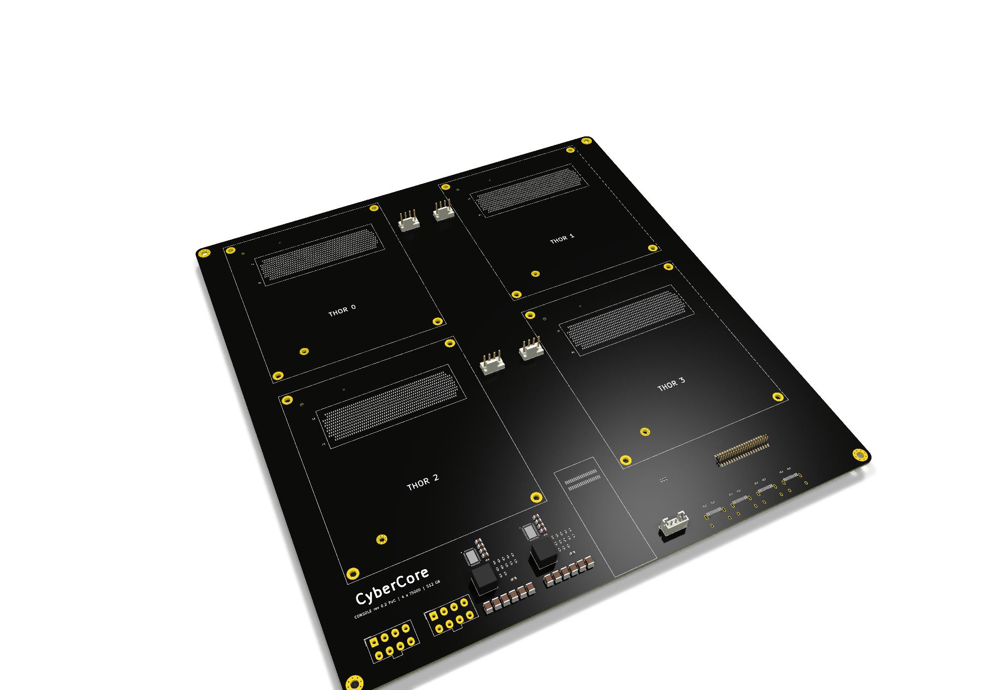
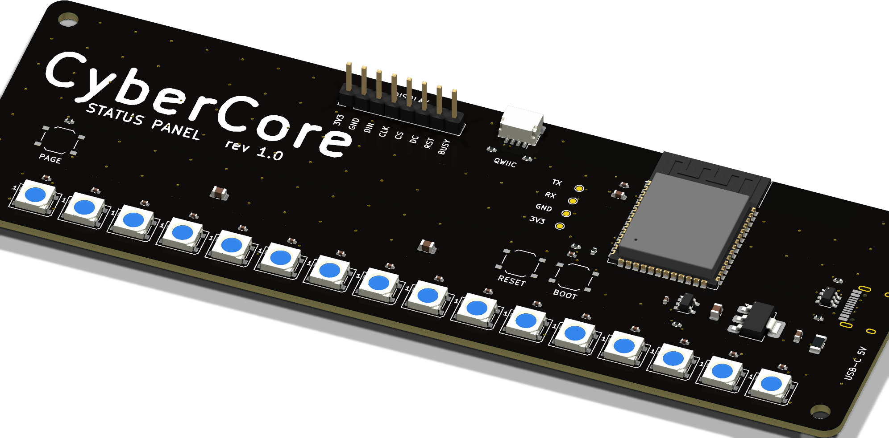

# CyberCore

**Open-hardware proof of concept: a slim black box that runs a frontier open LLM (DeepSeek V3.1, 671B) at home.**

CyberCore is a set of KiCad designs, each generated by a script so every choice is written down. Each one says plainly what is real and what is still a placeholder.

| Part | What | State |
|---|---|---|
| [**console/**](console/) | **CyberCore Console** carrier: 4 × NVIDIA Jetson T5000 (AGX Thor), 512 GB total, 25G mesh between modules, NVMe per module, QSFP28 uplink, 12-layer black board | rev 0.2 PoC: real pin map, Molex and SFF connector grids, TI power stage, DRC clean, **autorouting in progress**, open items listed |
| [**mgmt/**](mgmt/) | **Management board**: ESP32-S3 + I/O expanders that sequence, reset and monitor the 4 modules over ribbon cables, 4 module consoles on one USB-C | Designed, every signal level sourced from NVIDIA's docs, ERC clean, parts in stock. **Routing not finished** (6 layers, 84 connections open) |
| [**panel/**](panel/) | **Status panel**: ESP32-S3, 16 RGB LEDs, SPI display, USB-C. The console's face | rev 1.0: **routed, DRC clean, every part in stock at JLCPCB, orderable** |
| [**enclosure/**](enclosure/) | **Case**: 252 × 300 × 64 mm, front intake, 4 rear exhaust fans, STL tray + lid | Concept: fit checked, cooling budget by hand calculation |
| [**pcb/**](pcb/) | **CyberCore XL** concept: our own GPU + AMD EPYC with 3.2 TB unified memory, 22 layers | Dream board: the GPU and the AMD socket can't be built or sourced (see why inside) |
| [REAL-BUILD.md](REAL-BUILD.md) | The buy-it-today version: an 8-GPU AMD Instinct server, with power, cooling and cost | Plan |

## How fast?
DeepSeek V3.1 has 671B parameters, of which 37B are active per token. At 4-bit, that's ~400 GB of weights.
- **Console (4 × Thor, 512 GB, 4 × 273 GB/s):** an estimated 10-25 tok/s for one user. It's limited by memory bandwidth: every token has to read ~18.5 GB of weights.
- **Server (8 × AMD MI350X, 2.3 TB, 64 TB/s):** fast enough for many users, but it draws ~10-14 kW.

These are estimates from bandwidth math, not measurements. The PoC is how we find out.

## Tools
- KiCad 10, scripted through its Python (`pcbnew`)
- Freerouting 2.5 for the panel
- JLCPCB parts API for the stock checks

Each folder's README has its own rebuild steps.

## Not included
NVIDIA's design guide and its pin description spreadsheet are not in this repo. They're a free download from developer.nvidia.com, and `console/make_console.py` reads them from your copy.

## License
CyberCore is **open hardware, and it stays open**.

| What | License |
|---|---|
| Hardware: KiCad boards, footprints, schematics, Gerbers, BOMs, docs | [CERN-OHL-S-2.0](LICENSE) (CERN Open Hardware Licence v2, strongly reciprocal) |
| Software: the Python generator scripts | [GPL-3.0-or-later](LICENSE-SOFTWARE) |
| The CyberCore name and logo | Not licensed: see [TRADEMARKS.md](TRADEMARKS.md) |

What that means:
- **You may** build it, change it and sell it, including commercially.
- **If you ship hardware based on it**, you must publish your modified design files under the same license, keep the credit notices, and print or include the source location.
- **The CyberCore name stays with Louis Studios.** A copy must use its own name.

**Source location:** https://github.com/Louistuis/cybercore

Hardware is provided as is: each README lists the dimensions that are not confirmed yet, so check them before you order anything.
