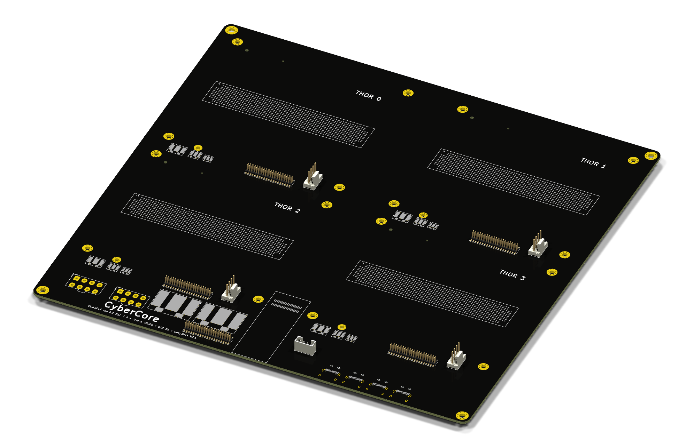

# CyberCore Console (rev 0.1, proof of concept)

A slim, black, console-sized box that runs **DeepSeek V3.1 (671B)** locally, on our own carrier board with
**4 × NVIDIA Jetson T5000 (AGX Thor) modules**. Each module has 128 GB of memory, so there is **512 GB in total**.



## What's on the board
| Block | What | Status |
|---|---|---|
| Compute | 4 × Jetson T5000 module, 699-pin Molex Mirror Mezz, 2.5 mm connector = **5 mm** between board and module | Pin map **real** (NVIDIA). Footprint geometry is a placeholder |
| Memory | 4 × 128 GB LPDDR5X = 512 GB (273 GB/s per module, per NVIDIA's spec) | On the modules |
| Module-to-module | Full mesh: each module's MGBE C0-C2 (UPHY lanes 12-14) wired straight to the 3 others, 6 links, AC caps on the back | Nets real, not routed |
| Uplink | Each module's MGBE C3 → one lane of a QSFP28 cage (4 × 25G breakout = one port per module) | Placeholder footprint |
| Storage | 1 × M.2 2280 NVMe per module on the back (PCIe C5 x4, UPHY lanes 8-11), each holding its share of the model | Nets real, stock footprint |
| Power | 12 V in through 2 × EPS-style Mini-Fit Jr 8-pin (~600 W). Per module: 12 V eFuse (SYS_VIN_HV), 5 V switch (SYS_VIN_MV), 3.3 V switch (SYS_VIN_SV). Shared 5 V 20 A and 3.3 V 15 A bucks | Power blocks are sized placeholders |
| Management | Per module: 2×20 1.27 mm header with power sequencing, reset, recovery, thermal, debug UART, I2C. One system header for the bucks + QSFP sideband | Real connectors. The BMC board that plugs in is not designed yet |
| Service | 4 × USB-C on the rear (each module's USB0, used for recovery and flashing) | Real |
| Front | The black **CyberCore status panel** (`../panel/`) plugs into J3 (module 0's USB1 + 5 V) | Panel is finished and orderable |
| Cooling | 4 fan headers, each module driving its own blower (FAN_PWM / FAN_TACH) | Real connectors; the thermal design is not done |

Board: 240 × 232 mm, 12 layers (HDI rules: 0.10 mm clearance), 1.6 mm, **black solder mask, ENIG**.
All parts go on the top except the M.2 drives and AC caps, which sit on the back. Nothing sits under a module: the design guide forbids it with the 2.5 mm connector.

## The model math (DeepSeek V3.1)
- **Size:** 671B parameters at 4-bit ≈ 380-400 GB.
  - 512 GB minus each module's OS share leaves ~460 GB, so it fits with ~50 GB for context cache.
  - 8-bit (~700 GB) does **not** fit.
- **Per token:** 37B active parameters ≈ 18.5 GB read per token.
- **Speed:**
  - Layers split across the 4 modules (pipeline): one module works at a time, so the ceiling is 273 GB/s ÷ 18.5 GB ≈ **15 tok/s**.
  - Experts split across all 4 modules working at once over the 25G mesh: the ceiling is ~1.1 TB/s ÷ 18.5 GB ≈ **59 tok/s**. Mesh latency on every layer eats into that.
  - **Estimate: about 10-25 tok/s for one user.** Measure it before believing it.
  - For scale: a 512 GB Apple Mac Studio does ~17-25 tok/s on this model, and hosted datacenter services ~200.
- **Power:** ~520 W for the modules at full power + NVMe + fans ≈ 600 W.
- **Module cost:** NVIDIA lists the T5000 at $4,999 each (1,000-unit price), so ~$20k for 4 before the board and case.

## Build status (honest)
**Real now:**
- Board outline and the 12-layer black stackup
- Every connection the board makes to each module's 699 pins, taken from NVIDIA's pin description spreadsheet: power, GND, PCIe, MGBE, USB, management
- Stock connectors (M.2, USB-C, Mini-Fit Jr, fan headers, management headers)
- DRC: 0 violations (with 499 unrouted connections, because nothing is routed yet)

**Placeholders (fix before ordering):**
1. **Mirror Mezz footprint geometry.** The 1.30 mm column pitch is from Molex's listing. The row pitch and the connector's position inside the module outline are **assumed**.
   - Get the exact part from NVIDIA's Supported Components List (DA-12429-001), plus Molex's 203456 drawing.
   - Check against NVIDIA's reference layout. The carrier-side pinout is a mirror image (DG-12084 fig. 3-2).
2. **Module standoff positions.** Assumed at the outline corners, inset 3 mm.
3. **QSFP28 footprint.** Pin numbers follow SFF-8679; pad geometry and the cage are approximate.
4. **Five power blocks.** Sized pads only; each needs a real converter or eFuse design.
5. **MGBE reference clock.** The design guide needs an external oscillator (tables 7-22 and 7-26), and it isn't on the board yet.

**Open questions:**
- **The direct MGBE-to-MGBE mesh.** XFI is meant to drive an SFP+ module. A short PCB link acts like a passive copper cable, but it must be checked against design guide section 7.3.
- **25 GbE speed.** NVIDIA says it is "being validated", so plan on 10G per link until it is confirmed.
- **Sequencing.** Every module has its own SYS_VIN_SV → MV/HV → MODULE_POWER_ON sequence (DG-12084 chapter 5). It runs on the management board, which isn't designed yet.
- **Cooling.** ~600 W in a slim box needs vapor chambers on the modules' thermal plates and 4 blowers. That's the hardest part of "slim".

**Not done:** routing (12-layer HDI, with length-matched 25G and PCIe Gen4 pairs), the BMC board, the enclosure, and power/thermal simulation.

## Rebuild
1. Download NVIDIA's *Jetson Thor Series Modules Design Guide* (DG-12084-001, free from developer.nvidia.com).
2. Extract its attachments: `pdfdetach -saveall -o datasheets/nv_attach <guide.pdf>`.
3. Run the build script with KiCad's Python:
```
/Applications/KiCad/KiCad.app/Contents/Frameworks/Python.framework/Versions/Current/bin/python3 make_console.py
kicad-cli pcb drc -o drc.rpt console.kicad_pcb
```
NVIDIA's documents and the pin spreadsheet are **not** in this repo; the script reads them from your own download.
