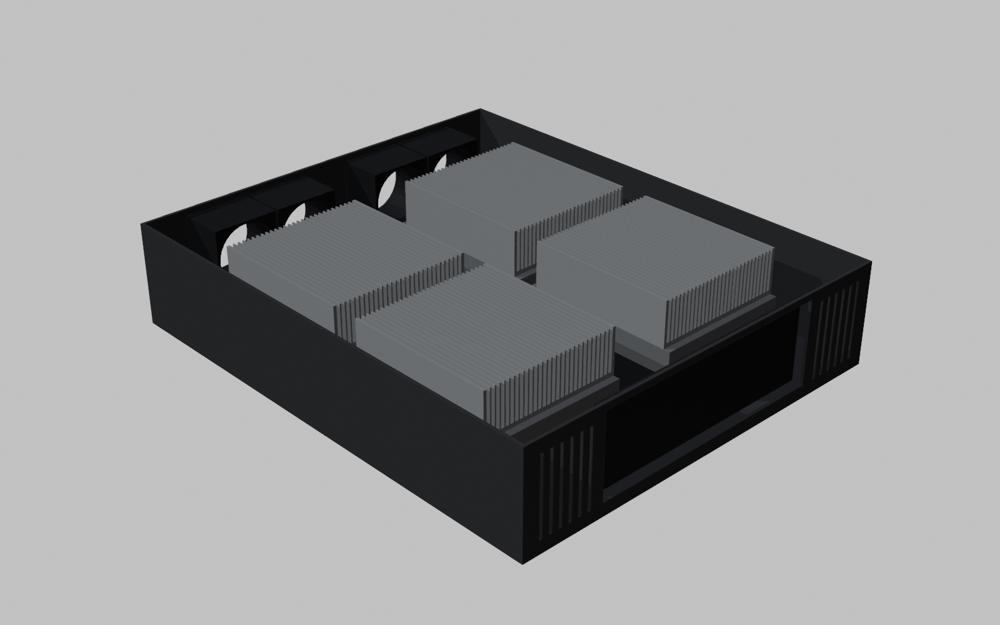

# CyberCore Console enclosure (rev 0.1, concept)

A slim black box around the console carrier: **252 × 300 × 64 mm, about 4.8 litres**. Air comes in at the front, passes through the four module heatsinks and leaves through four exhaust fans in the rear wall.



| Part | File | Notes |
|---|---|---|
| Tray (floor + walls) | `enclosure_tray.stl` | Rear: 4 fan openings, QSFP28 window, 4 USB-C slots, power cable gland. Front: status panel window and intake slots. M3 standoffs at the carrier's 4 holes |
| Lid | `enclosure_lid.stl` | Intake slots over the front modules, 4 screw holes |
| Everything else in the renders | (reference only) | Carrier, modules, heatsinks, fans and the status panel, to check fit |

`make_enclosure.py` builds the whole thing in Blender (headless), exports both parts and renders the previews:
```
/Applications/Blender.app/Contents/MacOS/Blender -b -P make_enclosure.py
```

## Height stack
| Layer | mm |
|---|---|
| Floor | 2.0 |
| Standoffs (room for the M.2 drives and parts on the back) | 8.0 |
| Carrier board | 1.6 |
| Board to module (Mirror Mezz, 2.5 mm part) | 5.0 |
| Jetson T5000, including its thermal transfer plate (DS-11945: 15.29 mm) | 15.3 |
| Heatsink fins | 28.0 |
| Air gap + lid | 4.0 |
| **Outside height** | **64** |

## Cooling budget
NVIDIA's limit is the module's thermal transfer plate: **80 °C maximum** for the T5000 (DS-11945). Default power mode is 120 W; MAXN is capped at 130 W.

| Item | Value |
|---|---|
| Heat to remove | 4 × 120 W modules + ~32 W NVMe + ~25 W power stage + fans ≈ **540 W** (≈ 580 W at MAXN) |
| Fans | 4 × 40 × 40 × 28 mm, 12 V high-speed server fans (~24 CFM free air each, ~12-15 CFM through the fins) ≈ 50-60 CFM total |
| Air temperature rise through the box | 540 W ÷ (1.16 kg/m³ × 1007 J/kg·K × 0.026 m³/s) ≈ **18 K** |
| Air reaching the front modules | room + ~2 K |
| Air reaching the rear modules | room + ~10 K (the front pair has already heated it) |
| Heatsink needed, front module (30 °C room) | (80 − 32 − 5) ÷ 120 W ≈ 0.36 K/W |
| Heatsink needed, rear module | (80 − 40 − 5) ÷ 120 W ≈ **0.29 K/W** |
| Heatsink expected | 87 × 92 × 28 mm, ~48 fins at 1.8 mm pitch ≈ 0.22 m² of fin area: ≈ 0.09 K/W fins + ≈ 0.08 K/W base, spreading and thermal paste ≈ **0.17 K/W** |

So it closes with some margin at 120 W per module, and the rear pair is the tight spot at MAXN. These are hand calculations, not a simulation.

## What it needs that the model doesn't show yet
- **Baffles.** The 37 mm channel between the two module columns and the gaps beside the heatsinks let air bypass the fins. Thin baffles must force the air through them.
- **The heatsinks themselves.** Each one bolts to a module's thermal transfer plate. Its mounting pattern has to come from NVIDIA's thermal design guide (TDG-12271), which isn't downloaded yet.
- **Noise.** Four 40 mm fans at full speed are server-loud (roughly 55-60 dBA). The fan headers have PWM and tach, so the management board can slow them down at idle. A quiet version needs a taller box (around 88 mm) with 80 mm fans.
- **Power supply.** It's external: 12 V at 50 A (600 W), for example a server power supply with a 12 V breakout board, cabled through the rear gland to J1 and J5.
- **Material.** The STL files are a 3D-printable reference. For a 600 W box, bent 2 mm aluminium sheet is the better choice and also helps carry heat away.

**Status: concept.** The fit and the cooling math are checked, but there is no thermal simulation and nothing has been built.
