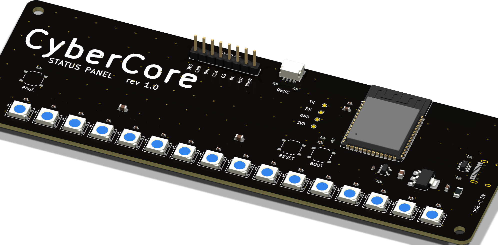

# CyberCore status panel (rev 1.0)

The front panel of the CyberCore Console: a black 150 × 50 mm board with an ESP32-S3, a 16-LED RGB bar and a plug-in SPI display. It shows tokens/s, power and temperatures.
**This board is finished and orderable:** it's routed, DRC is clean, and every part is in stock at JLCPCB.

## What it does
- **Brain:** ESP32-S3-WROOM-1-N16R8 (Wi-Fi + native USB).
  - Data comes over USB from the machine itself: a small agent on the host writes stats to the USB serial port.
  - It can also pull data over Wi-Fi from a BMC (Redfish).
- **LED bar:** 16 × XL-5050RGBC-2812B (WS2812B type). A 74AHCT1G125 level-shifts the 3.3 V data line to 5 V.
  - Firmware caps the total current at ~400 mA so a USB 2.0 port can power it.
- **Display:** an 8-pin 2.54 mm header in Waveshare's module order (VCC GND DIN CLK CS DC RST BUSY).
  - It fits their SPI e-Paper modules (pin 8 = BUSY) and their SPI LCD modules (pin 8 = backlight), using the PH2.0 cable those modules ship with.
- **Power:** USB-C, 5 V, with a 1.5 A PTC fuse, ESD protection (USBLC6-2SC6) and an AMS1117 3.3 V regulator.
- **Also on board:** a Qwiic / STEMMA QT I2C port, PAGE / RESET / BOOT buttons, UART test pads and 4 × M3 holes.

## Board
- 2 layers, 1.6 mm, **black solder mask, white silk, ENIG**. JLCPCB standard rules (0.15 mm), with 2 USB necks at 0.125 mm.
- **Routing:** Freerouting, with GND poured on both layers and 98 stitching vias.
- **DRC:** 0 violations, 0 unconnected.
- **ERC:** 0 errors. There are 126 warnings because the symbols are embedded in the schematic, not in a library.

## Files
| File | What |
|---|---|
| `parts.py` | Netlist: every part, pin, LCSC number (checked 2026-11-16) and datasheet note |
| `make_panel.py` | Places parts and writes `panel.kicad_pcb` |
| `route.py` | `export` → Freerouting → `import` → `panel_routed.kicad_pcb` (+ black stackup) |
| `gen_sch.py` | Writes `panel.kicad_sch` from parts.py |
| `jlc_files.py` | `jlc/BOM.csv`, `jlc/CPL.csv`, `jlc/gerbers.zip` |

## Before ordering
1. In JLC's placement preview, check the rotation of every polarised part: U1-U4, D1-D16 and J1-J3.
2. Confirm the XL-5050RGBC-2812B pinout (1 VDD, 2 DOUT, 3 VSS, 4 DIN) against its datasheet.
3. Check the display pin order against the exact Waveshare module you buy.
4. Order settings: black mask, ENIG, 1.6 mm, 2 layers.
